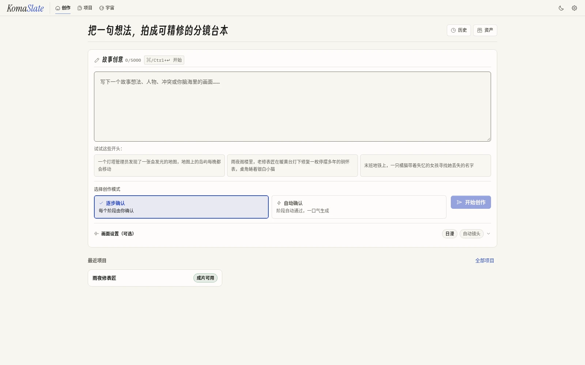
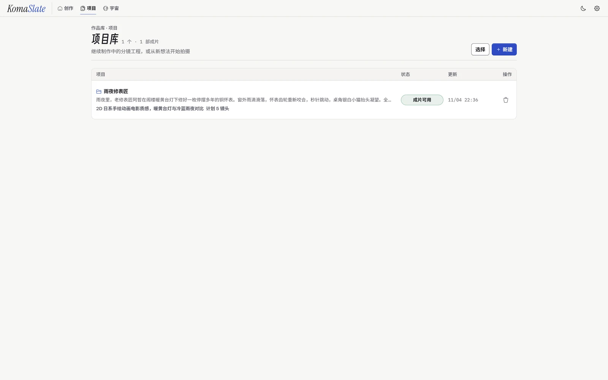
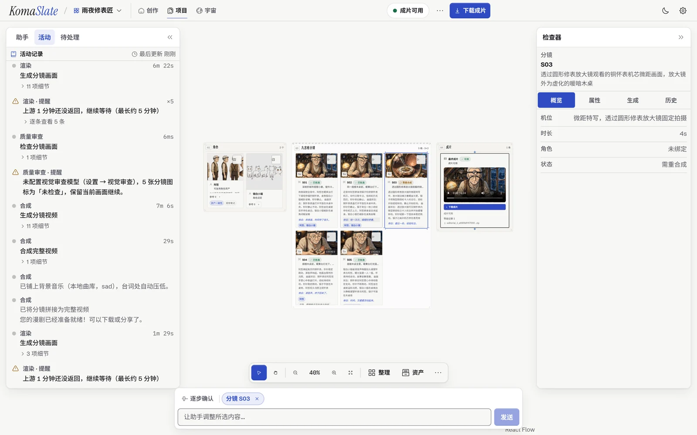
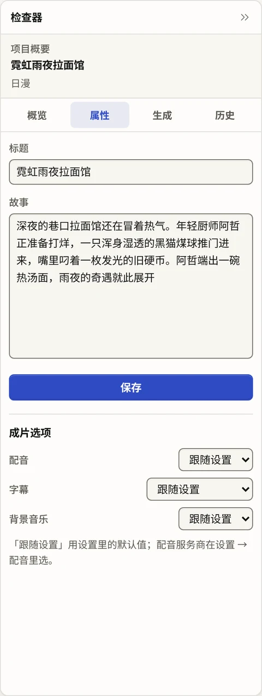
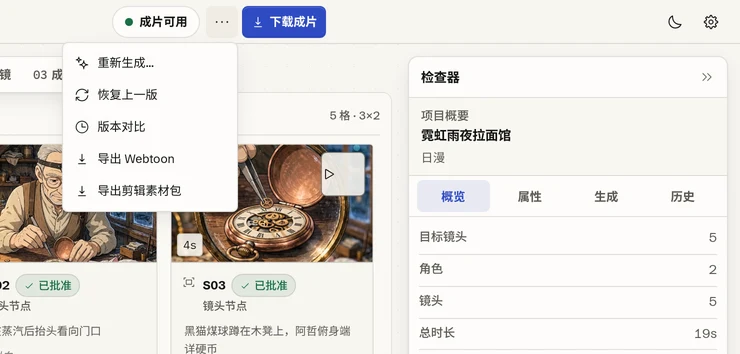
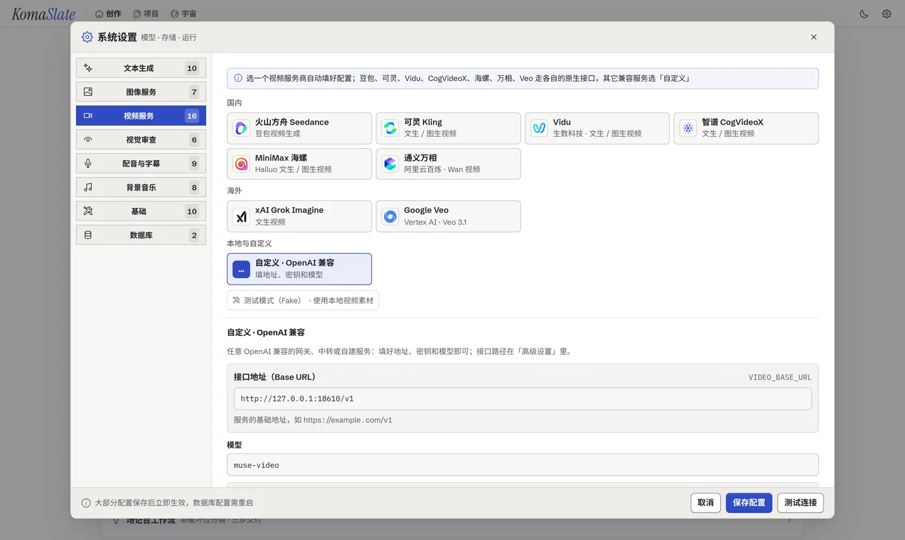
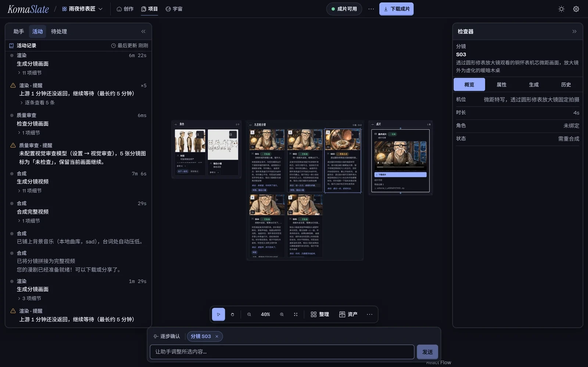
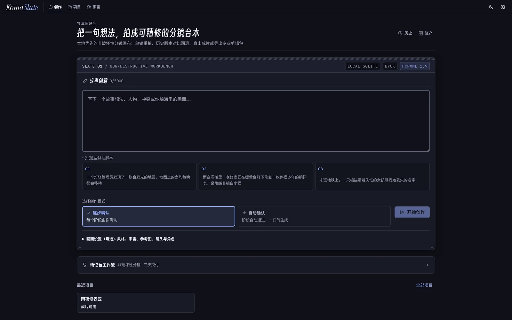

# KomaSlate

<div align="center">
  

  <p><strong>本地优先、可编辑、非破坏性的 AI 分镜与短片工作台</strong></p>
  <p><em>Local-first, editable, non-destructive AI storyboarding workspace · formerly <strong>openOii</strong></em></p>

  <p>
    
    
    
    
    
    
  </p>

  <p>
    <a href="#为什么选择-komaslate">核心特性</a> ·
    <a href="#界面预览">界面预览</a> ·
    <a href="#架构">架构</a> ·
    <a href="#快速开始">快速开始</a> ·
    <a href="#路线图">路线图</a>
  </p>
</div>

## ☁️ 赞助商 · Bloome

<table>
  <tr>
    <td align="center" width="58%" valign="top">
      <a href="https://bloome.im/app?utm_medium=github&utm_source=Xeron2000-openOii-ivor-202607">
        
      </a>
    </td>
    <td width="42%" valign="middle">
      <p>也在研究像 <strong>KomaSlate（原 openOii）</strong> 这样的分阶段可控 AI 工作流？</p>
      <p>
        <a href="https://bloome.im/app?utm_medium=github&utm_source=Xeron2000-openOii-ivor-202607"><strong>Bloome</strong></a>
        让 Claude、ChatGPT、DeepSeek 等多个 AI 在同一对话里协作——互相质疑、交叉核对、一起把结果打磨到位。
      </p>
      <ul>
        <li>零配置，云端即用</li>
        <li>网页与移动端均可使用</li>
        <li>配置好的 Agent 可分享给团队</li>
      </ul>
      <p><strong>👉 <a href="https://bloome.im/app?utm_medium=github&utm_source=Xeron2000-openOii-ivor-202607">免费试用 Bloome</a></strong></p>
    </td>
  </tr>
</table>

<sub>💼 面向 AI 视频/图像 API 网关与开发者工具开放赞助合作展位，欢迎通过 GitHub Issue 或主页联系方式洽谈。</sub>

---

**KomaSlate**（取自日语分镜格 *Koma* 与影视场记板 *Slate*，原名 **openOii**）是一套面向创作者与独立开发者的**开源非破坏性 AI 分镜工作台**。

不同于消耗黑盒积分、改一处重跑全片的闭源云端工具，KomaSlate 将剧本拆解、角色设定、分镜关键帧、视频片段生成与多版本历史沉淀在**本地单个 SQLite 数据库与分镜画布**中：你可以随时停在任意审批门微调提示词、锁定已满意的角色与镜头、仅对单镜头重绘或重拍视频、对比前后版本差异并一键回退，最终直出带配音字幕的短片或导出到专业剪辑软件精剪。

## 为什么选择 KomaSlate

- **🎬 镜头级非破坏性编辑与版本回退**：支持单角色重绘、单镜头画面重绘与单镜头视频重拍；每次修改自动记录版本快照，提供并排字段与画面 Diff 抽屉（Version Compare）及一键回退，已批准冻结的镜头不会被重跑覆盖。
- **🎭 角色资产绑定与双重一致性把关**：自动拼接角色设定图与多张参考图注入分镜渲染，结合视觉大模型（Vision Critique）自动审查与 InsightFace 人脸特征余弦比对，在生成视频前拦截角色跑偏与崩坏画面。
- **🧭 15 阶段确定性工作流 + 6 道审批门**：`大纲 → 角色 → 分镜 → 角色立绘 → 分镜关键帧 → 视频片段 → 成片合成` 全流程状态机驱动；支持「逐步确认」与「自动确认」两种节奏，具备执行租约（Lease）与检查点恢复，断线或中断后从断点续跑。
- **🔑 本地优先（Local-First）与自备密钥（BYOK）**：项目、资产、媒体与版本历史完全保存在本地（SQLite WAL + 本地静态目录），零平台抽成；内置国内外主流文本、图像、视频、视觉审查、配音与背景音乐服务商预设卡片及免费只读连通性测试，并提供零成本 `Fake` 测试模式跑通全链路。详见 [docs/providers.md](docs/providers.md)。
- **🎞️ 内置成片合成与多格式导出**：内置可选的角色多音色 TTS 配音、字幕（软字幕 / 画面烧录）与背景音乐自动闪避混音（FFmpeg），支持一键下载 MP4 成片、A4 漫画 PDF 与 Webtoon 竖屏长图。
- **💬 受控的项目对话助手**：基于 [pi-agent-core](https://github.com/badlogic/pi-mono/tree/main/packages/agent) 内置工作台对话助手，可查询状态、批量润色分镜或发起局部重生成；**所有涉及计费或修改内容的操作均需人工确认卡片放行**，审批门仅由创作者本人操作。

## 界面预览

<table>
  <tr>
    <td align="center" width="50%">
      
      <br />
      <sub><strong>首页 · 写下故事，选择逐步确认或自动确认</strong></sub>
    </td>
    <td align="center" width="50%">
      
      <br />
      <sub><strong>项目库 · 每个项目的阶段状态一目了然</strong></sub>
    </td>
  </tr>
  <tr>
    <td align="center" colspan="2">
      
      <br />
      <sub><strong>工作台 · 活动记录（含视觉审查评分）、React Flow 分镜画布与属性/历史检查器</strong></sub>
    </td>
  </tr>
  <tr>
    <td align="center" width="50%">
      
      <br />
      <sub><strong>成片选项 · 配音 / 字幕 / 背景音乐</strong></sub>
    </td>
    <td align="center" width="50%">
      
      <br />
      <sub><strong>导出与历史 · 下载成片、导出 Webtoon、版本对比与回退</strong></sub>
    </td>
  </tr>
  <tr>
    <td align="center" colspan="2">
      
      <br />
      <sub><strong>BYOK 设置 · 视频服务商预设（文本、图像、视觉审查、配音、背景音乐同样内置预设）</strong></sub>
    </td>
  </tr>
  <tr>
    <td align="center" width="50%">
      
      <br />
      <sub><strong>深色主题 · 分镜工作台</strong></sub>
    </td>
    <td align="center" width="50%">
      
      <br />
      <sub><strong>深色主题 · 首页</strong></sub>
    </td>
  </tr>
</table>

## 架构

**确定性阶段工作流 + 受控对话助手**，共用一个 TypeScript 引擎与单个本地 SQLite 文件：

- **工作流引擎**（`engine/src/pipeline`）：15 个阶段由确定性状态机按契约（`contracts/workflow.json`）顺序推进——文本规划与审查阶段通过 [pi-ai](https://github.com/badlogic/pi-mono/tree/main/packages/ai) 解析结构化输出，图像 / 视频阶段支持整跑与单资产定向重跑（Targeted Run），成片阶段调用 FFmpeg 完成音画字幕合成。**下一步执行什么严格由状态机与失效计划决定，不由大模型自由发挥。**
- **项目对话助手**（`engine/src/agent`）：基于 [pi-agent-core](https://github.com/badlogic/pi-mono/tree/main/packages/agent) 的工具循环，仅调用后端产品 API；写操作强制经过人工确认门禁，无法越权替用户通过阶段审批门。
- **产品后端与媒体工具**（`backend/`）：FastAPI 负责 HTTP/WebSocket 契约、版本快照与回退、导出服务以及引擎网关，并提供参考图拼合、TTS/BGM 处理与 InsightFace 人脸向量计算等本地媒体工具。

```text
frontend/ (React 18 + React Flow)  ──HTTP/WS──▶  backend/ (FastAPI 网关)  ──loopback──▶  engine/ (Workflow + Agent)
                                                               └────── 共享 SQLite（WAL）+ /static 本地媒体 ──────┘
```

工作流、视觉审查与对话助手共用 `engine/src/pi-models.ts` 的统一模型注册表（`createModels()`）。详细边界约束见 [AGENTS.md](AGENTS.md)，历史架构演进见 [docs/adr](docs/adr)。

## 快速开始

### 方式一：Docker Compose 一键启动

```bash
cp backend/.env.example backend/.env   # 默认可用 Fake 测试模式零成本体验全流程
docker compose up -d
```

启动后访问 `http://localhost:15173` 即可进入工作台并在「设置」页配置自己的模型 API Key。

### 方式二：本地源码运行（零容器）

环境要求：Python 3.10+ 与 [uv](https://docs.astral.sh/uv/)、Node.js 22.19+ 与 `pnpm`、系统已安装 `ffmpeg`。

```bash
cp backend/.env.example backend/.env   # 想先零成本跑通全链路：保持 TEXT/IMAGE/VIDEO_PROVIDER=fake

# 1. 安装引擎依赖（首次触发生成时后端会自动在 127.0.0.1:18766 拉起引擎 sidecar）
cd engine && pnpm install && cd ..

# 2. 启动后端 API（:18765，启动时自动执行 SQLite 迁移）
cd backend && uv sync && uv run uvicorn app.main:app --reload --host 127.0.0.1 --port 18765

# 3. 另开终端启动前端工作台（:15173）
cd frontend && pnpm install && pnpm dev
```

如需单独调试引擎进程，也可手动启动：

```bash
cd engine && \
ENGINE_DB_PATH=../backend/data/openoii.db ENGINE_BACKEND_DIR=../backend \
ENGINE_STATIC_DIR=../backend/app/static ENGINE_PYTHON=../backend/.venv/bin/python pnpm dev
```

打开 http://localhost:15173 开始创作，接口文档位于 http://localhost:18765/docs 。

开发验证命令：`backend` 下 `uv run pytest`，`engine` 下 `pnpm test`，`frontend` 下 `pnpm test` / `pnpm e2e`。

## 路线图

- [x] 15 阶段确定性生成流水线、6 道人工审批门与租约断点恢复
- [x] 单角色 / 单镜头定向重生成、多版本 Diff 对比与历史回退
- [x] 国内外主流模型 BYOK 预设卡片与零扣费连通性探测
- [x] 自动配音、字幕、背景音乐成片合成及 PDF / Webtoon 导出
- [ ] **非破坏性分镜增强**：重规划保留已冻结分镜、重绘附带局部修改指令、分镜角色绑定可视化编辑与空角色空镜放行
- [ ] **通用剪辑工程导出**：一键导出按镜号命名的分镜素材包（ZIP：关键帧 / 视频片段 / 配音 / SRT 字幕）与标准 **FCPXML** 时间线（兼容 DaVinci Resolve、Premiere Pro、Final Cut Pro、剪映专业版/CapCut 导入）
- [ ] **品牌平滑迁移**：仓库、CLI 与 UI 标识逐步从 `openOii` 过渡至 `KomaSlate`

## 🙏 致谢

- [Linux.do](https://linux.do/) - 强烈推荐！高质量技术社区，感谢佬友们的公益站和热心支持 ❤️

## License

MIT
